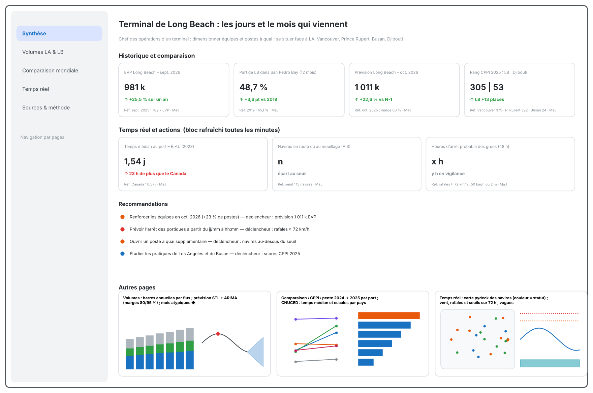

# Fiche de conception – Tableau de bord portuaire (terminal de Long Beach)

19/11/2026 · Auteur : à compléter

## Pour qui, pour quelle décision

**Utilisateur :** le chef des opérations d'un terminal à conteneurs du Port of Long Beach.

**Décision :** dimensionner les équipes (dockers, grutiers) et les postes à quai pour les jours et le mois qui viennent ; situer Long Beach face à ses concurrents (Los Angeles, Vancouver, Prince Rupert), à Busan et à Djibouti.

**Outil :** application Streamlit en 5 pages ; historique lu dans des CSV, météo en cache 1 h, récepteur AIS continu ; clé d'API dans les secrets Streamlit.

## Indicateurs (7 tuiles)

| Indicateur | Référence | Source | Fréquence |
| --- | --- | --- | --- |
| EVP Long Beach, dernier mois connu | même mois de l'année précédente | BTS (d'après le port) | mensuelle |
| Part de Long Beach dans San Pedro Bay (12 mois) | moyenne 2019 | BTS ; Port of LA | mensuelle |
| Prévision Long Beach du mois suivant, marge à 80 % | même mois N-1 réel | modèle STL + ARIMA | mensuelle |
| Rang CPPI 2025 de Long Beach et de Djibouti | édition 2024 ; Vancouver, Prince Rupert, Busan | Banque mondiale & S&P Global | annuelle |
| Temps médian au port, tous navires, États-Unis | Canada | CNUCED (UNCTADstat) | annuelle |
| Navires en route ou au mouillage dans la zone | seuil : 15 navires | aisstream.io | en continu |
| Heures d'arrêt probable des grues sur 48 h | rafales ≥ 72 km/h ; 50 km/h ou 2 m (vigilance) | Open-Meteo | toutes les heures |

## Fonctions intelligentes et recommandations

- **Prévision :** STL + ARIMA(1,1,0), horizon 3 mois, marges 80 % et 95 % ; test sur 12 mois : 7,4 % d'erreur contre 9,4 % pour la méthode naïve.
- **Anomalies :** forêt d'isolement (variation annuelle et mensuelle), 5 % des mois.
- **Alerte météo :** heures d'arrêt probable des grues et de vigilance sur 48 h.
- **Recommandations :** équipes du mois prochain, arrêt des grues, poste à quai supplémentaire, comparaison CPPI ; chacune avec son déclencheur.

**Limites :** Long Beach via le BTS ; Djibouti absent de la CNUCED en accès libre ; CPPI et CNUCED jamais mélangés ; AIS gratuit faible à Djibouti ; seuils à valider.

## Maquette

